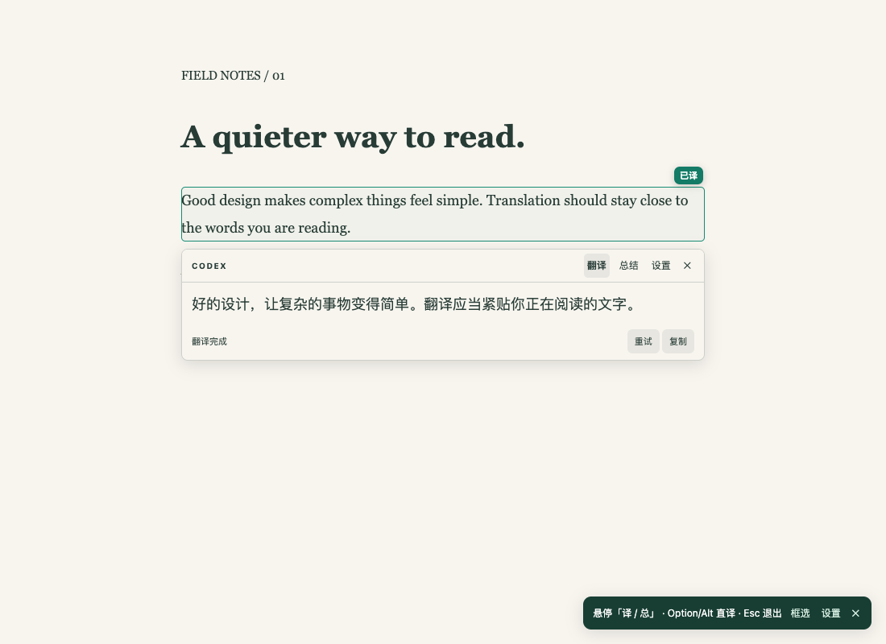
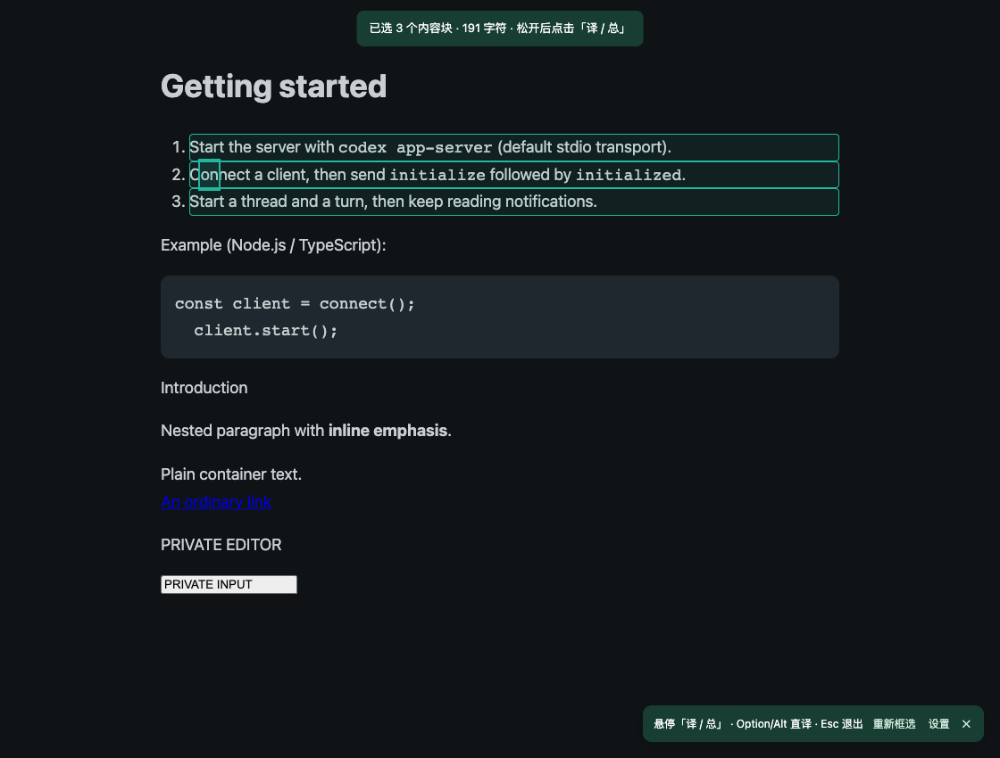
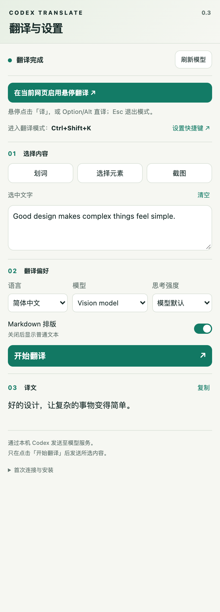

# Codex Translate

用本机 Codex 在 Chrome 中翻译和总结网页，结果直接显示在原文旁。



## 安装前准备

- **macOS + Chrome 116+**（目前安装脚本仅支持 macOS）。
- **Python 3.9+、Node.js 20+**（含 npm）。
- 已安装并登录 **Codex**，账号可以正常使用模型。

## 安装：三步完成

### 1. 下载并构建

点击本仓库的 **Code → Download ZIP**，解压后，在项目文件夹中打开终端，运行：

```bash
npm ci
npm run build
```

### 2. 加载扩展

1. 在 Chrome 地址栏输入 `chrome://extensions`。
2. 打开右上角的「开发者模式」。
3. 点击「加载已解压的扩展程序」，选择项目里的 **`dist` 文件夹**。
4. 在 Chrome 工具栏的扩展菜单中，将 **Codex Translate** 固定。

### 3. 注册本地桥接

在项目终端运行一次，让 Chrome 能调用本机 Codex：

```bash
python3 scripts/install_host.py dkphlioelbflcdppiljpajdgffmlccck
```

上面是仓库默认的扩展 ID；若 Chrome 显示的 ID 不同，请替换为实际 ID。扩展连接时会自动查找 Codex。

完成后，在 `chrome://extensions` 刷新扩展，再刷新要翻译的网页。

> 请保留项目文件夹。移动或重命名文件夹后，需要重新运行注册命令。

## 怎么用

### 翻译一段文字

1. 打开网页，点击工具栏的 **Codex Translate** 图标。
2. 鼠标停在要翻译的段落上，出现按钮后点击 **「译」**。
3. 译文会逐步显示在原文旁；点击 **「总」** 可以总结这段内容。

按住 **Option / Alt** 悬停可直接翻译；按 **Esc** 退出翻译模式。普通悬停只显示按钮，不发送内容。

### 一次翻译多段

在网页上右键，选择扩展子菜单中的 **「框选」**，拖出矩形，松开后点击 **「译」或「总」**，一起处理高亮的内容块。



选区太小时，点击 **「+」** 可逐层扩大范围。译文浮卡支持 **复制、停止、重试**，点击段落旁的 **「已译 / 已总」** 标记可以回看结果。

### 换语言、换模型或翻译截图

点击网页右下角提示条或译文浮卡中的 **「设置」**，打开侧边栏：

- 选择目标语言、模型和思考强度，修改后自动保存。
- 选中文字后点 **「划词」**，或直接粘贴文字，再点 **「开始翻译」**。
- 点 **「截图」**，框出要翻译的区域，再点 **「开始翻译」**（需要支持图片的模型）。
- 点 **「设置快捷键」**，可绑定进入翻译模式的按键，默认未设置。



<sub>配图来自扩展实际界面，使用演示页面和模拟模型结果。</sub>

## 常见问题

**无法连接 Codex？** 在项目终端运行：

```bash
python3 -B scripts/doctor.py
```

正常时会显示 `handshake OK`、登录信息和模型列表。若未登录，用诊断输出的 Codex 可执行文件运行 `login`。若找不到 Codex，可指定路径重新注册：

```bash
python3 scripts/install_host.py dkphlioelbflcdppiljpajdgffmlccck --codex "/你的路径/codex"
```

**网页没有反应？** 刷新网页，再点扩展图标。Chrome 内部页面、扩展商店和部分内置 PDF 页面无法直接选取内容，可改用侧边栏粘贴文字。

**更新后怎么生效？** 重新运行 `npm ci` 和 `npm run build`，在 `chrome://extensions` 刷新扩展，再刷新网页并重新打开侧边栏。

更多问题见 [排错说明](docs/TROUBLESHOOTING.md)。

## 使用须知

- 通过本机 Codex 调用模型服务，**不是离线翻译**；请求会使用当前 Codex 账号的额度或 API 计费。
- 只在点击翻译、总结，或使用 Option / Alt 直译时发送所选文字或截图；扩展不读取或保存登录令牌。
- 悬停和框选一次最多处理 12,000 字符，框选最多 200 个内容块；截图只包含当前可见区域。
- 网页译文暂存在当前浏览器会话中，结束会话后清除；侧边栏不保存翻译历史。

## 开发

```bash
npm run dev        # 监听源码变化并构建
npm run typecheck  # TypeScript 类型检查
npm test           # Python 单元测试
npm run check      # 完整检查，首次需 npx playwright install chromium
```

技术栈：Chrome Manifest V3、TypeScript、原生 HTML / CSS、Python Native Messaging。无需 HTTP 后端或数据库。

源码位于 `src/`，静态资源位于 `extension/`，本地桥接位于 `native/`。`dist/` 是构建产物，不提交到 Git。

[架构与协议](docs/ARCHITECTURE.md) · [测试说明](docs/TESTING.md)
