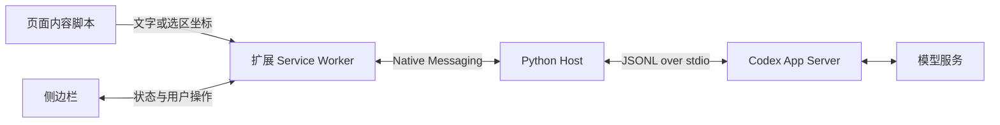

# 架构与开发协议

## 数据流



- 页面脚本负责选区和悬停浮卡，不持有后端凭据。仅在用户启用的顶层页面接受 hoverTranslate 请求；任意页面脚本不能直接调用 runtime 接口。
- Service Worker 保留原文、译文与进行中的请求，拥有唯一 Native Messaging port。流式更新节流为 40ms，截图只在源内容变化时广播。
- Python host 用 asyncio 读取 Codex 输出，用线程读取 Chrome 的阻塞 stdin。多个控制消息可以并发处理，模型翻译限制为一个。
- App Server 启动后完成 `initialize` → `initialized`；通过 `account/read` 检查登录，通过分页 `model/list` 获得模型目录。
- 每次翻译创建独立 ephemeral thread，传入所选模型和目标语言。`turn/start` 传原文，截图通过临时 `localImage` 路径输入。
- `item/agentMessage/delta` 追加译文；排除显式标记为 commentary 的消息。`item/completed` 的最终文本用于校准增量结果。
- 根据 `threadId`、`requestId` 过滤事件，避免旧任务覆盖新结果。`turn/completed` 结束任务；`turn/interrupt` 用于停止。
- 翻译结束后取消订阅临时对话、删除图片目录。ephemeral 会话不作为普通持久化翻译历史保存。

## 扩展到 Python 的消息

Chrome Native Messaging 是 UTF-8 JSON，前置 4 字节本机字节序长度。它与 Codex 的 JSONL 不同，不能直接对接两个进程而省略桥接。

```json
{"type":"connect"}
{"type":"translate","requestId":"uuid","text":"Hello","language":"简体中文","model":"目录中的模型 ID","effort":"low"}
{"type":"cancel","requestId":"uuid"}
```

截图翻译另加 `image: "data:image/png;base64,..."`。前端不能提供任意本地文件路径。后端校验类型、大小、语言和模型能力，再自行写入私有临时目录。

返回消息：

```json
{"type":"ready","models":[],"loggedIn":true,"authType":"chatgpt"}
{"type":"delta","requestId":"uuid","text":"你好"}
{"type":"error","requestId":"uuid","message":"错误说明"}
{"type":"done","requestId":"uuid","text":"你好","cancelled":false}
```

错误后仍发送 `done` 以释放 UI 忙状态；UI 必须保留错误提示。连接失败的错误没有 requestId。不能把模型文字作为 HTML 注入，界面使用 textContent。

## 选区与截图

划词使用 `window.getSelection()`。元素模式使用 `elementFromPoint()` 与 `innerText`，不发送完整 HTML、表单值或整个页面。↑/↓ 在父子范围之间调整；捕获阶段拦截点击避免导航。注入脚本具有幂等标记，结束时移除监听器与遮罩。

截图模式记录 CSS 视口坐标；先移除遮罩并等待两个动画帧，再发出截图请求。Service Worker 检查来源标签仍为活动标签，然后 captureVisibleTab，用实际图片宽高除以视口宽高计算缩放，在 OffscreenCanvas 裁剪为 PNG。这比直接假定 devicePixelRatio 更稳妥。

## 权限与数据

Chrome 权限：activeTab（用户触发后临时读取当前页）、scripting（选区脚本）、sidePanel、contextMenus、storage（仅模型/语言偏好）、nativeMessaging。不申请所有网站长期读取权限。

后端使用只读 sandbox、禁止审批升级，提示中将网页与截图视为数据。会话配置关闭 shell、Code Mode、应用、插件、子代理和网页搜索，并设置空 MCP 配置。不同版本的配置语义可能变化，部署时应验证有效配置；只读 sandbox 本身不代表禁止读取所有文件，也不构成面向不可信多租户的完整隔离。初版面向本人本机使用，不对网络开放、不接受任意 shell 命令。不要将 Native Messaging 接口转发为无鉴权网络服务。

Codex 登录由现有 CLI 管理，扩展不会复制 auth.json、密钥或 token。程序不记录原文/截图内容日志；Codex 自身的运行状态及上游服务数据处理仍由其配置和政策决定。

## 扩展方向

可在 host 中抽象 Translator 接口，接入独立 API 或本地模型；前端保持 connect/translate/cancel 协议。后续可以增加逐段双语插入、术语表、更多 iframe 支持和可选历史。

## 依据

- [Codex App Server](https://learn.chatgpt.com/docs/app-server)
- [Codex 身份验证](https://learn.chatgpt.com/docs/auth)
- [Chrome Native Messaging](https://developer.chrome.com/docs/extensions/develop/concepts/native-messaging)
- [Side Panel](https://developer.chrome.com/docs/extensions/reference/api/sidePanel)
- [captureVisibleTab](https://developer.chrome.com/docs/extensions/reference/api/tabs#method-captureVisibleTab)

本机实测发现 `readOnly.access` 字段虽出现在部分文档/导出 schema 中，0.155.0-alpha.9.2 在调用时拒绝该字段；当前实现使用兼容的 `readOnly` 类型，不宣称实现了限定目录的读取隔离。


## 0.2 悬停交互

新增 extension/hover.js，使用 Shadow DOM 隔离样式。普通悬停 450ms 显示“译”；可信鼠标点击或 Option/Alt 悬停发起请求。过滤输入框、可编辑区域和超过 12,000 字符的容器，拒绝页面伪造的 pointer/key 事件。原文始终不改写。

工具栏点击通过 activeTab 注入脚本；不新增全站 host_permissions。后台在 storage.session 保存当前会话中启用的标签 ID，以便 Service Worker 休眠重启后恢复权限记录；导航/关闭标签时清除。

网页发出 hoverTranslate / hoverCancel / hoverSettings / hoverDisable。后端路由记录 tabId + documentId + requestId，只把 hoverState 发送到请求所属文档；不把完整模型目录、原始截图或其他标签原文广播到页面。侧边栏仍同步当前任务状态。

hoverTranslate 使用 storage.local 保存的模型/思考强度/目标语言，必要时自动连接 Native Messaging。连接阶段即可取消；提交后调用同一个 native cancel 协议。关闭浮卡会取消进行中的请求，忽略迟到事件。仅支持单个全局翻译任务，不会因切换段落默默发起并发请求。

悬停结果保存在 `chrome.storage.session` 的会话内存，按 tab ID + 不含 hash 的页面 URL 分隔，每页最多 60 个段落。记录 DOM 子元素路径和原文；刷新后仅当路径与文字都匹配才恢复标记，避免把旧结果贴到新内容。单个段落分别存 `translate` 与 `summary`，只有成功完成的请求写入，取消或报错不写入。浏览器会话结束后缓存清除，不增加长期磁盘翻译历史。卡片位置及标记随滚动/resize 重算，通过 textContent 显示结果，避免执行模型生成的 HTML。

## 0.3 总结、暂存与快捷键

普通悬停 450ms 显示“译 / 总”，两种操作共享现有 Native Messaging 流和单任务限制。`hoverTranslate` 携带 `kind` 与段落路径，后台以 `task: summary` 或 `task: translate` 转发给 Python host；host 为摘要使用独立提示词，仍按当前设置的目标语言返回。后台验证请求来源是已启用的顶层标签，并按 `documentId` 回传流式状态。扩展命令 `enter-translation-mode` 在当前标签启用模式，无默认按键；侧栏通过 `chrome.commands.getAll()` 显示用户绑定，并提供 Chrome 快捷键设置入口。Esc 与停用按钮共用退出逻辑，清理页面状态并通过 `hoverDisable` 撤销后台启用状态。
