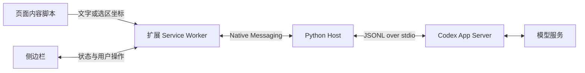

# 架构与开发协议

## 数据流



- 页面脚本负责选区和悬停浮卡，不持有后端凭据。仅在用户启用的顶层页面接受 hoverTranslate 请求；任意页面脚本不能直接调用 runtime 接口。
- Service Worker 保留原文、译文与进行中的请求，拥有唯一 Native Messaging port。流式更新节流为 40ms，截图只在源内容变化时广播。
- Python host 用 asyncio 读取 Codex 输出，用线程读取 Chrome 的阻塞 stdin。多个控制消息可以并发处理，模型翻译限制为一个。
- App Server 启动后完成 `initialize` → `initialized`；通过 `account/read` 检查登录，通过分页 `model/list` 获得模型目录。
- 每次翻译创建独立 ephemeral thread，传入所选模型和目标语言。`turn/start` 传原文，截图通过临时 `localImage` 路径输入。
- `item/agentMessage/delta` 追加译文；排除显式标记为 commentary 的消息。`item/completed` 的最终文本用于校准增量结果。
- 根据 `threadId`、`requestId` 过滤事件，避免旧任务覆盖新结果。`turn/completed` 结束任务；`turn/interrupt` 用于停止。
- 翻译结束后取消订阅临时对话、删除图片目录。ephemeral 会话不作为普通持久化翻译历史保存。

## 扩展到 Python 的消息

Chrome Native Messaging 是 UTF-8 JSON，前置 4 字节本机字节序长度。它与 Codex 的 JSONL 不同，不能直接对接两个进程而省略桥接。

```json
{"type":"connect"}
{"type":"translate","requestId":"uuid","text":"Hello","language":"简体中文","model":"目录中的模型 ID","effort":"low"}
{"type":"cancel","requestId":"uuid"}
```

截图翻译另加 `image: "data:image/png;base64,..."`。前端不能提供任意本地文件路径。后端校验类型、大小、语言和模型能力，再自行写入私有临时目录。

返回消息：

```json
{"type":"ready","models":[],"loggedIn":true,"authType":"chatgpt"}
{"type":"delta","requestId":"uuid","text":"你好"}
{"type":"error","requestId":"uuid","message":"错误说明"}
{"type":"done","requestId":"uuid","text":"你好","cancelled":false}
```

错误后仍发送 `done` 以释放 UI 忙状态；UI 必须保留错误提示。连接失败的错误没有 requestId。不能把模型文字作为 HTML 注入：Markdown 先词法解析，再通过固定标签的 DOM 节点和 textContent 显示。

## 选区与截图

划词使用 `window.getSelection()`。元素模式使用 `elementFromPoint()` 与 `innerText`，不发送完整 HTML、表单值或整个页面。↑/↓ 在父子范围之间调整；捕获阶段拦截点击避免导航。注入脚本具有幂等标记，结束时移除监听器与遮罩。

截图模式记录 CSS 视口坐标；先移除遮罩并等待两个动画帧，再发出截图请求。Service Worker 检查来源标签仍为活动标签，然后 captureVisibleTab，用实际图片宽高除以视口宽高计算缩放，在 OffscreenCanvas 裁剪为 PNG。这比直接假定 devicePixelRatio 更稳妥。

## 权限与数据

Chrome 权限：activeTab（用户触发后临时读取当前页）、scripting（选区脚本）、sidePanel、contextMenus、storage（仅模型/语言偏好）、nativeMessaging。不申请所有网站长期读取权限。

后端使用只读 sandbox、禁止审批升级，提示中将网页与截图视为数据。会话配置关闭 shell、Code Mode、应用、插件、子代理和网页搜索，并设置空 MCP 配置。不同版本的配置语义可能变化，部署时应验证有效配置；只读 sandbox 本身不代表禁止读取所有文件，也不构成面向不可信多租户的完整隔离。初版面向本人本机使用，不对网络开放、不接受任意 shell 命令。不要将 Native Messaging 接口转发为无鉴权网络服务。

Codex 登录由现有 CLI 管理，扩展不会复制 auth.json、密钥或 token。程序不记录原文/截图内容日志；Codex 自身的运行状态及上游服务数据处理仍由其配置和政策决定。

## 扩展方向

Host 已通过 Translator 接口解耦供应商，前端保持 connect/translate/cancel 协议。后续可以增加逐段双语插入、术语表、更多 iframe 支持和可选历史。

## 依据

- [Codex App Server](https://learn.chatgpt.com/docs/app-server)
- [Codex 身份验证](https://learn.chatgpt.com/docs/auth)
- [Chrome Native Messaging](https://developer.chrome.com/docs/extensions/develop/concepts/native-messaging)
- [Side Panel](https://developer.chrome.com/docs/extensions/reference/api/sidePanel)
- [captureVisibleTab](https://developer.chrome.com/docs/extensions/reference/api/tabs#method-captureVisibleTab)

本机实测发现 `readOnly.access` 字段虽出现在部分文档/导出 schema 中，0.155.0-alpha.9.2 在调用时拒绝该字段；当前实现使用兼容的 `readOnly` 类型，不宣称实现了限定目录的读取隔离。


## 0.2 悬停交互

新增悬停入口（现为 `src/entries/hover.ts`），使用 Shadow DOM 隔离样式。普通悬停 450ms 显示“译”；可信鼠标点击或 Option/Alt 悬停发起请求。过滤输入框、可编辑区域和超过 12,000 字符的容器，拒绝页面伪造的 pointer/key 事件。原文始终不改写。

工具栏点击通过 activeTab 注入脚本；不新增全站 host_permissions。后台在 storage.session 保存当前会话中启用的标签 ID，以便 Service Worker 休眠重启后恢复权限记录；导航/关闭标签时清除。

网页发出 hoverTranslate / hoverCancel / hoverSettings / hoverDisable。后端路由记录 tabId + documentId + requestId，只把 hoverState 发送到请求所属文档；不把完整模型目录、原始截图或其他标签原文广播到页面。侧边栏仍同步当前任务状态。

hoverTranslate 使用 storage.local 保存的模型/思考强度/目标语言，必要时自动连接 Native Messaging。连接阶段即可取消；提交后调用同一个 native cancel 协议。关闭浮卡会取消进行中的请求，忽略迟到事件。仅支持单个全局翻译任务，不会因切换段落默默发起并发请求。

悬停结果保存在 `chrome.storage.session` 的会话内存，按 tab ID + 不含 hash 的页面 URL 分隔，每页最多 60 个段落。记录 DOM 子元素路径和原文；刷新后仅当路径与文字都匹配才恢复标记，避免把旧结果贴到新内容。单个段落分别存 `translate` 与 `summary`，只有成功完成的请求写入，取消或报错不写入。浏览器会话结束后缓存清除，不增加长期磁盘翻译历史。卡片位置及标记随滚动/resize 重算，渲染模型结果只创建固定标签与文本节点，避免执行模型生成的 HTML。

## 0.3 总结、暂存与快捷键

普通悬停 450ms 显示“译 / 总”，两种操作共享现有 Native Messaging 流和单任务限制。`hoverTranslate` 携带 `kind` 与段落路径，后台以 `task: summary` 或 `task: translate` 转发给 Python host；host 为摘要使用独立提示词，仍按当前设置的目标语言返回。后台验证请求来源是已启用的顶层标签，并按 `documentId` 回传流式状态。扩展命令 `enter-translation-mode` 在当前标签启用模式，无默认按键；侧栏通过 `chrome.commands.getAll()` 显示用户绑定，并提供 Chrome 快捷键设置入口。Esc 与停用按钮共用退出逻辑，清理页面状态并通过 `hoverDisable` 撤销后台启用状态。


## 跨元素矩形选择

启用网页模式时注入自包含的 `hover.js`。源码 `src/page/region-selection.ts` 负责正文块发现、矩形相交、文本提取、DOM 路径和缓存恢复；`src/entries/hover.ts` 负责显式框选入口、指针捕获、实时高亮、浮卡与取消。普通悬停和框选共用 `{elements, paths, source}` 选区对象，单段落也是只有一个元素的选区。

Chrome 网页右键扩展子菜单固定为「点选 / 框选」两项，均适用于网页正文、选中文字、链接和媒体，复用 `activeTab` 授权并注入 `hover.js`，不会直接打开侧栏或提交模型请求。「点选」发送 `hoverEnable`、`mode: hover`，退出框选或扩大后的固定选区并恢复悬停；「框选」发送 `mode: region`，直接开启遮罩，无需提前启用悬停，也可通过右下角「框选」进入。

矩形与段落、列表项、标题、代码块等语义块相交即纳入完整内容；缺少语义块时使用不含下级正文块的普通容器。按 DOM 顺序合并，命中集合内的后代去重，不选取公共祖先。可编辑区、表单、隐藏元素和扩展 UI 被排除，相交计算裁去视口及祖先滚动容器外的部分。提取保留块级换行及代码缩进，不发送 HTML。每帧合并拖动更新；松开后固定选区，点击操作才调用模型。反向拖动、空白、轻点、超限、Esc、失焦、指针中断和切换选择器均有显式收尾。

`hoverTranslate` 使用 `paths: number[][]` 替代单一 `path`，原有 `requestId/text/kind` 不变。后台限制 1–200 条非空路径、每条最多 30 层，拒绝非法索引、重复路径和祖先/后代重叠；原文合计仍不超过 12,000 字符。完整路径组参与 `pageCache:v2:<tabId>:<URL>` 的记录键，缓存最多 60 个选区，全部路径和原文一致才恢复。旧缓存格式不迁移。保留已有标签授权、documentId 路由、请求取消及单任务约束。

侧边栏和 Python host 接收到的仍是合并后的纯文本及原有任务类型，无需改动 Native Messaging 消息。框选不会扩大 Chrome 读取权限。

## Translator 边界

- `host.py` 负责消息帧、边界校验、单请求约束、增量和最终结果转发、统一错误及脱敏日志。
- `translator.py` 使用 Protocol 定义 `connect()`、`translate(request, on_delta)`、`cancel(request_id)`、`close()`；请求、结果、就绪状态和能力使用 dataclass。模型与思考强度可选，模型描述保持现有 Chrome 字段结构。
- `codex_translator.py` 处理 Codex 特有的模型校验、临时会话、任务提示词、事件过滤、取消与图片清理；`codex_client.py` 负责子进程与 JSON-RPC。

Host 创建时注入一个长期复用的 Translator；默认使用 Codex。能力声明用于在发起调用前拒绝不支持的总结或截图任务。非流式服务可以完全不调用增量回调，直接返回 `TranslationResult`；最终结果覆盖增量草稿。服务异常由 Host 转成 `error` 后再发 `done`，保持前端解除忙碌状态。取消只路由到匹配的请求，取消后的增量及旧请求迟到的增量会被丢弃。进程退出时先收回任务，再关闭供应商。

`CodexClient.start()` 通过启动锁和进程存活检查复用同一 app-server。临时会话及图片按请求清理，150 秒结果等待与 35 秒协议调用超时仍由 Codex 实现管理。Chrome 无法向接口传入任意本地文件路径。

本次未接入有道 API、密钥或服务切换界面。未来接入时实现 Translator 并注入 Host，再扩展前端服务选择、语言和能力展示；当前前端仍按 Codex 模型列表工作。

## Markdown 与显示偏好

Codex 提示词统一要求 Markdown，翻译保留原文结构，总结按核心结论、主题要点与必要子要点组织；消息契约和单请求约束不变。原始结果仍保存于后台与会话缓存，`chrome.storage.local.markdown` 是纯展示偏好，只有布尔值 `false` 表示普通文本，缺省为 Markdown。

侧边栏和浮卡从 `src/shared/markdown.ts` 导入同一渲染实现，构建时各自打包固定版本的 Marked，无运行时脚本加载顺序或共享全局对象。Marked 只负责词法解析，共用模块将 token 转成固定标签的 DOM 树，文字通过 textContent / Text 节点写入，不使用模型生成的 HTML，不创建可导航链接或图片请求。普通文本从相同结构导出，保留段落、列表层次、编号与代码内容。复制按当前显示模式选择 Markdown 原文或普通文本。

两个视图监听 storage.onChanged，切换时立即重绘已有结果，浮卡重新计算位置，不发起模型请求。未变化的文本不重复解析。代码块和表格在结果区域内滚动，适配窄侧栏与原网页字体、颜色。依赖随扩展打包，不新增权限或网络服务；构建流程、依赖来源和许可证见下文。

浮卡从选区元素及内部正文块挑选排版基准：排除标题、代码、表头、导航和强调元素，去除包含下级正文块的重复候选，优先常规字重与非斜体，按同类字体样式的可见文本量选择主要正文。仅标题或强调内容则取其父容器，纯代码仍沿用代码块样式。定位更新时重新读取样式以跟随响应式页面。浮卡通过 CSS 变量将 Markdown 标题倍率限制为 1.04–1.16、代码字号设为正文的 0.96、表格字号设为正文的 1 倍；侧边栏保留独立的默认排版。


## TypeScript 构建与职责（2026-10-24）

- `src/entries/background.ts` 注册 Chrome 事件、验证调用方、分发消息和裁剪截图。
- `src/background/tasks.ts` 统一侧栏与悬停任务的准备、提交、取消、结果与错误收尾。当前任务只有 preparing / running / cancelling 三个阶段；无当前任务表示空闲，busy 从任务存在性推导。
- `src/background/native-client.ts` 独立管理长期 Native Port、就绪 Promise 与连接超时。准备阶段取消通过 AbortSignal 结束等待，迟到的 ready 不会提交已取消任务；已经提交的取消保持忙碌直到收到 done 或连接断开。
- 请求携带 panel / hover 来源；hover 来源包含标签、文档、页面 URL 与路径。只有当前请求接收增量和错误，取消后的增量丢弃，成功的最终结果才写入页面缓存。
- `src/shared/contracts.ts` 定义消息联合、请求返回值映射、原文、模型、偏好和缓存。`validation.ts` 在消息、Native Port 和存储入口解析 unknown，Python host 仍独立验证请求。
- 完整状态必须包含 source，广播只允许省略 source。省略表示保留，null 表示清空，流式刷新不重复传输截图。
- 悬停、框选中、已选定使用单一交互状态；模型请求独立记录运行/结束阶段。浮卡展示统一经 renderResult，模板与正文外观在 `src/page/hover-view.ts`。
- 原有全局 Markdown 和选区对象已移除，仅保留每个文档的入口初始化标记，防止重复注入创建额外监听器。

`tsc --noEmit` 执行严格类型检查，开启 noUncheckedIndexedAccess、exactOptionalPropertyTypes 和 isolatedModules。esbuild 按 manifest 的最低 Chrome 版本打包：后台和侧栏为 ESM，hover/content 为自包含 IIFE，不拆分运行时 chunk。静态资源和依赖许可证一起复制到 dist，Chrome 只加载 dist。dev 监听源码及静态文件的新增、更新与删除，并独立持续报告类型错误；build 必须先通过类型检查。

Marked 固定为 npm `marked@18.0.14`，源码：https://github.com/markedjs/marked ，MIT 许可证构建时复制到 `dist/licenses/marked.LICENSE`。更新版本需同步 package.json / package-lock.json，并运行完整回归；不再维护手工复制的 UMD 文件。所有脚本本地打包，不使用 CDN，不增加 web_accessible_resources 或网站权限。

Native Messaging 字段、Python Translator 边界、manifest key 和权限保持现有约定。开发版改为加载 dist 后应核对扩展 ID；旧版 extension 加载项需移除后重新加载生成目录。
